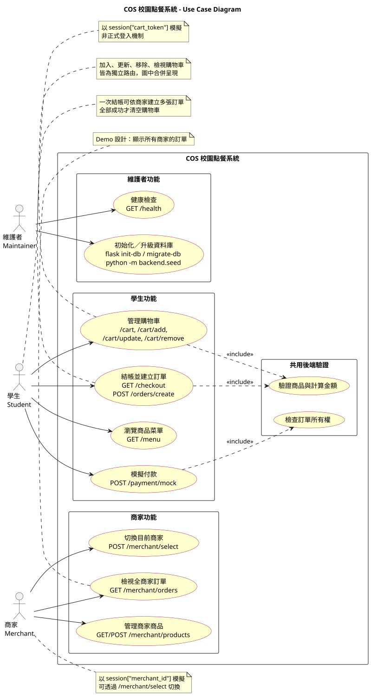
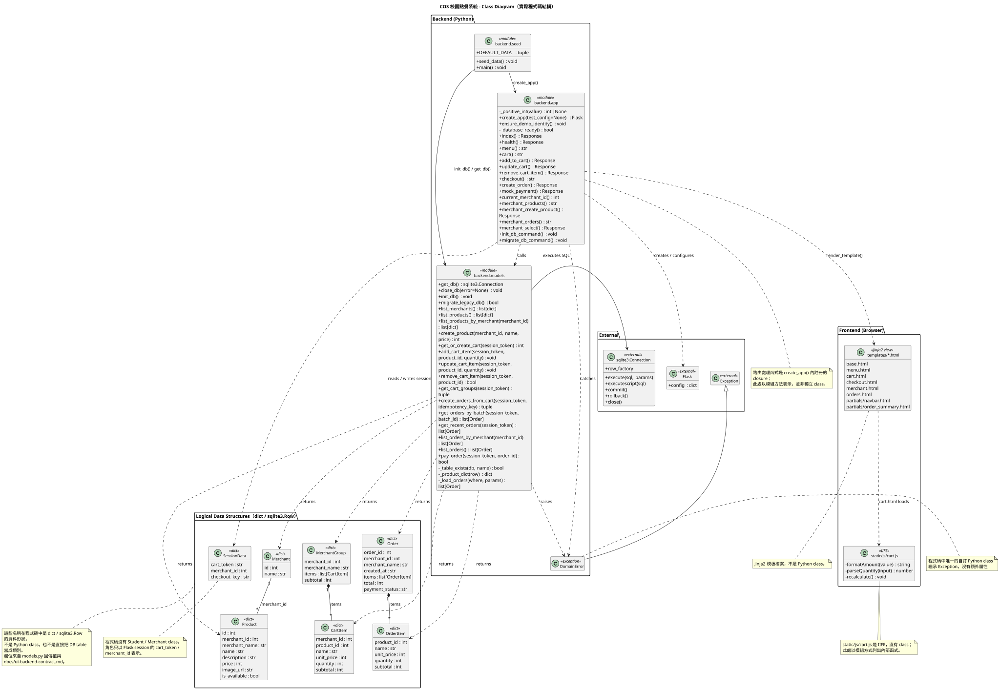
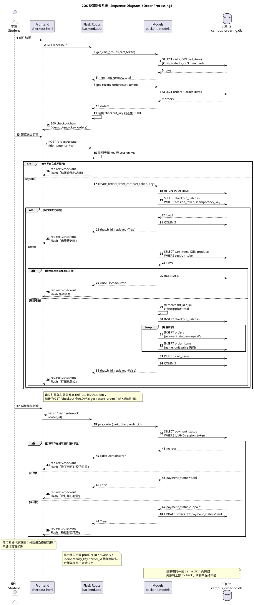

# COS UML Diagrams

本目錄的 UML 依目前程式碼、`README.md` 與 `docs/ui-backend-contract.md` 繪製，使用 PlantUML。分析時 `docs/architecture.md` 並未出現在工作區（已用檔案搜尋確認），因此不以其內容為依據；若之後補回該文件，可再交叉核對。圖中只呈現實際存在的路由、函式、資料結構與互動；沒有在程式碼中找到證據的功能不會被補上。

## 檔案

| 圖 | PlantUML | SVG | PNG |
| --- | --- | --- | --- |
| Use Case Diagram | [`use_case.puml`](use_case.puml) | [`use_case.svg`](use_case.svg) | [`use_case.png`](use_case.png) |
| Class Diagram | [`class_diagram.puml`](class_diagram.puml) | [`class_diagram.svg`](class_diagram.svg) | [`class_diagram.png`](class_diagram.png) |
| Sequence Diagram | [`sequence_diagram.puml`](sequence_diagram.puml) | [`sequence_diagram.svg`](sequence_diagram.svg) | [`sequence_diagram.png`](sequence_diagram.png) |

## 1. Use Case Diagram



**說明**

- 三個實際存在的操作角色：
  - **Student（學生）**：以 `session["cart_token"]` 模擬身分。
  - **Merchant（商家）**：以 `session["merchant_id"]` 模擬身分。
  - **Maintainer（維護者）**：執行 Flask CLI、seed 與健康檢查。
- 學生功能：瀏覽菜單、管理購物車、結帳並建立訂單、模擬付款。
- 商家功能：管理商家商品、切換目前商家、檢視全商家訂單。
- 維護者功能：初始化／升級資料庫、載入示範資料、健康檢查。
- `管理購物車` 在圖中合併呈現 `/cart`、`/cart/add`、`/cart/update`、`/cart/remove` 四個實際路由，明細見圖上註記。
- `建立訂單` 與 `加入購物車` 皆 `<<include>>` 後端的商品驗證與金額計算；`模擬付款` `<<include>>` 訂單所有權檢查。
- 角色是 Demo 用的 session 模擬，不是正式登入；`/merchant/orders` 顯示所有商家訂單也是 Demo 設計。

## 2. Class Diagram



**說明與建模限制**

- 本專案後端是**程序式 Flask 應用**，沒有 ORM，也沒有 Student、Merchant、Cart、Order 等 domain class。
- 圖中 `backend.app`、`backend.models`、`backend.seed`、`static/js/cart.js` 以 `<<module>>`／`<<IIFE>>` 表示，列出實際存在的函式；`DomainError` 是程式碼中唯一的自訂 Python class。
- `backend.app` 的路由處理函式實際上是 `create_app()` 內建立的 closure，圖中以模組方法呈現，並不代表它們是獨立類別。
- `Product`、`MerchantGroup`、`CartItem`、`Order`、`OrderItem` 等放在 **Logical Data Structures** 區，標示為 `<<dict>>`。它們是 `models.py` 回傳的 `dict`／`sqlite3.Row` 資料形狀，不是 Python class，也不是直接把資料表當成類別。
- 外部依賴 `Flask` 與 `sqlite3.Connection` 只列出程式實際使用的成員。
- 關係：
  - `backend.app` 呼叫 `backend.models`，並捕捉 `DomainError`。
  - `backend.models` 拋出 `DomainError`，透過 `sqlite3.Connection` 執行 SQL。
  - `backend.seed` 依賴 `create_app()`、`init_db()`、`get_db()`。
  - `templates` 由路由以 `render_template()` 使用；`cart.html` 載入 `cart.js`。
  - `DomainError` 繼承 `Exception`。

## 3. Sequence Diagram



**說明**

以 **Order Processing（多商家結帳與模擬付款）** 為例，參與者為：

- Student：操作瀏覽器。
- Frontend `checkout.html`：HTML 表單與重新導向。
- Flask Route：`GET /checkout`、`POST /orders/create`、`POST /payment/mock`。
- Models：`get_cart_groups()`、`get_recent_orders()`、`create_orders_from_cart()`、`pay_order()`。
- SQLite：`instance/campus_ordering.db`。

圖中呈現的實際流程：

1. `GET /checkout` 取得購物車分組、總額與最近訂單，必要時產生 `checkout_key`。
2. `POST /orders/create` 比對表單 `idempotency_key` 與 session key。
3. `create_orders_from_cart()` 以 `BEGIN IMMEDIATE` 開啟交易。
4. 同一 `(session_token, idempotency_key)` 已存在時直接回傳既有批次（`replayed=True`）。
5. 新批次會讀取購物車、驗證商品上架、依商家分組、計算金額、建立 `checkout_batches`／`orders`／`order_items`、清空購物車後 Commit。
6. 空購物車或商品下架時 Rollback 並拋出 `DomainError`。
7. `POST /payment/mock` 只允許本人未付款訂單，成功後更新為 `paid`；已付款或非本人訂單會顯示對應訊息。
8. 建立訂單與付款後都 redirect 到 `/checkout`，再由 `checkout()` 重新載入最近訂單。

## 重新產生圖片

本目錄圖片以 PlantUML 1.2024.7 產生。若本機有 `plantuml.jar`：

```powershell
java "-Dfile.encoding=UTF-8" -jar plantuml.jar -charset UTF-8 -tsvg docs\uml\*.puml
java "-Dfile.encoding=UTF-8" -jar plantuml.jar -charset UTF-8 -tpng -Sdpi=150 docs\uml\*.puml
```

## 程式碼證據與已知限制

- `docs/architecture.md` 在本次分析時不存在，因此本 UML 直接以程式碼、`README.md`、`docs/ui-backend-contract.md` 與測試為證據。
- 身分：`backend/app.py` 的 `ensure_demo_identity()` 使用 session，不是正式登入。
- 購物車與訂單：`backend/models.py` 的 `add_cart_item()`、`create_orders_from_cart()`、`pay_order()`。
- 路由：`backend/app.py` 的 `menu()`、`cart()`、`create_order()`、`mock_payment()`、`merchant_products()`、`merchant_orders()`。
- 前端：`templates/*.html`、`static/js/cart.js`；沒有 JavaScript class。
- 無庫存管理、無 CSRF、無真實金流、無 JSON API；這些未出現在 UML 中，以免暗示已實作。
